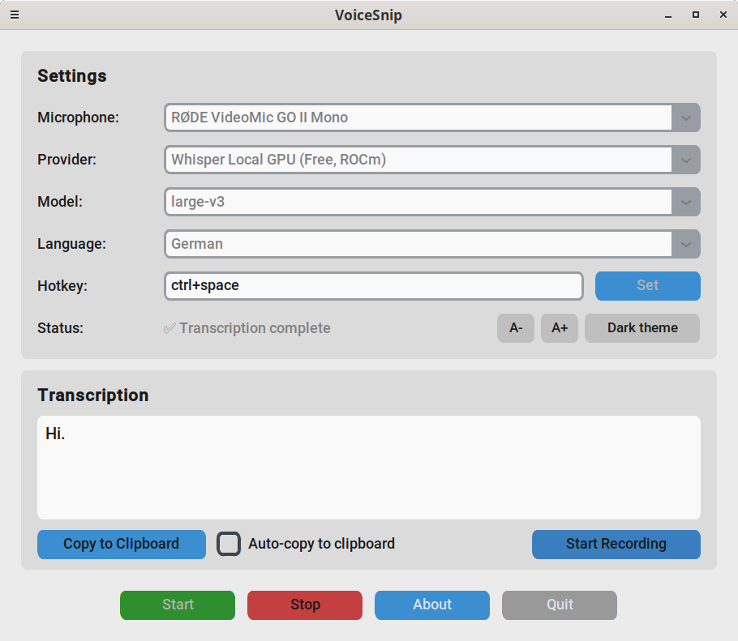

# VoiceSnip - Push-to-Talk Speech-to-Text

Local push-to-talk speech-to-text for Linux. Hold a hotkey, speak, release - text appears at your cursor.

All processing happens locally on your machine - on the CPU or a GPU. No cloud, no server, no data leaves your machine.



## Features

- **Push-to-Talk**: Hold hotkey to record, release to transcribe
- **Local Processing**: Whisper runs directly on your CPU or on your GPU - NVIDIA (CUDA), AMD (ROCm) or any GPU with a Vulkan driver, including AMD/Intel integrated graphics
- **Privacy-First**: All data stays on your device
- **Configurable Hotkeys**: Any key combination (Ctrl+Space, Alt+R, etc.)
- **Multi-Language**: 11 languages (German, English, French, Spanish, etc.) + Auto-Detection
- **Dark/Light Mode**: Switch between dark and light themes
- **Adjustable Font Size**: A-/A+ buttons to customize text size

## Requirements

- Linux (X11 or Wayland)
- Python 3.8+
- Any CPU, **or** NVIDIA GPU with CUDA, **or** AMD GPU with ROCm, **or** any GPU with a Vulkan driver (e.g. AMD/Intel iGPU)
- Debian/Ubuntu for automated system package install

## Installation

```bash
git clone https://github.com/Stefan-Schmidbauer/voicesnip.git
cd voicesnip
./install.py
```

The installer will ask you to choose a profile:

| Profile    | Description                                                                 |
| ---------- | --------------------------------------------------------------------------- |
| **cuda**   | Whisper with NVIDIA GPU acceleration (requires CUDA)                        |
| **rocm**   | Whisper with AMD GPU acceleration (requires ROCm, Linux)                    |
| **vulkan** | Whisper via whisper.cpp on any Vulkan GPU - recommended for AMD/Intel iGPUs |
| **cpu**    | Whisper on the CPU - no GPU required, works anywhere                        |

### GPU Setup

**NVIDIA (CUDA):** Install [NVIDIA drivers](https://developer.nvidia.com/cuda-downloads). CUDA libraries are installed automatically by the installer.

**AMD (ROCm):** Install [ROCm drivers](https://rocm.docs.amd.com/projects/install-on-linux/en/latest/) first. PyTorch ROCm is installed automatically by the installer. For integrated AMD graphics use the `vulkan` profile instead - ROCm is not reliable on iGPUs (the Radeon 780M hangs under load).

**Vulkan (AMD/Intel iGPU, any GPU):** Uses [whisper.cpp](https://github.com/ggml-org/whisper.cpp) through the GPU's Vulkan driver (Mesa RADV for AMD, ANV for Intel). No ROCm or CUDA needed. The installer checks for a Vulkan GPU and compiles whisper.cpp with Vulkan support, which takes a few minutes. As a reference, `turbo` transcribes a 10-second dictation in about 0.9 s on a Radeon 780M. Tested on AMD (Radeon 780M) and NVIDIA; Intel iGPUs should work through Mesa's ANV driver but have not been tested yet.

With more than one GPU, the first one is used. The installer lists the Vulkan GPUs with their index; select another one with `VOICESNIP_VULKAN_DEVICE`, e.g. `VOICESNIP_VULKAN_DEVICE=1 ./start.sh`, or set it permanently in `.env` (see `.env.example`).

**CPU:** No extra setup - the `cpu` profile runs on any machine without GPU drivers.

## Usage

```bash
./start.sh
```

1. Select your microphone
2. Click "Start"
3. Hold your hotkey (default: Ctrl+Space) and speak
4. Release - text appears at your cursor

## Wayland Support

VoiceSnip provides the same workflow on both X11 and Wayland — hold your hotkey
anywhere, speak, release, and the text appears at your cursor. The display
server is detected at runtime; the difference is purely internal.

On Wayland the text is pasted with `ydotool`. Both `ydotool` 0.1.x and 1.x are
supported: they disagree about where the daemon's socket lives and about the
syntax of `ydotool key`. Both socket locations are probed, and the installed
version is detected once so the right key syntax is used from the start. Two
environment variables adjust the paste if needed:

| Variable                   | Purpose                                              |
| -------------------------- | ---------------------------------------------------- |
| `YDOTOOL_SOCKET`           | Path to the `ydotoold` socket, when it is not in the default place |
| `VOICESNIP_PASTE_SHORTCUT` | Shortcut used to paste, e.g. `ctrl+shift+v` for terminals |

### X11

- **Global hotkey** via pynput
- Text is typed at your cursor via `xdotool`

### Wayland

Wayland's compositor blocks the usual global keyboard hook and synthetic typing,
so VoiceSnip uses two lower-level mechanisms instead:

- **Global hotkey** by reading `/dev/input/event*` directly (`python-evdev`).
  This requires your user to be in the **`input`** group.
- Text is inserted by copying it to the clipboard and pasting with **Ctrl+V**
  via `ydotool` (which needs access to `/dev/uinput`).

The installer sets both up for you: it adds you to the `input` group and
installs a udev rule for `/dev/uinput`. **Group changes only take effect after
the next login**, so log out and back in (or reboot) once after installing,
then the hotkey works system-wide just like on X11.

> **Clipboard note:** On Wayland, text is inserted by placing it on the
> clipboard, pasting it, and then restoring your previous clipboard contents.
> Only the **primary clipboard format** is restored — content that advertises
> multiple formats at once (e.g. rich text with `text/html` + `text/plain`, or
> images offering several types) keeps just the primary type; the other formats
> are dropped. This is a limitation of restoring a clipboard offer with
> `wl-copy`, which handles one MIME type per entry.

## Whisper Models

| Model    | Size   | Memory\* | Notes                   |
| -------- | ------ | -------- | ----------------------- |
| tiny     | 78 MB  | 230 MB   | Fastest, lowest quality |
| base     | 149 MB | 330 MB   |                         |
| small    | 488 MB | 745 MB   | Good balance            |
| medium   | 1.5 GB | 2 GB     |                         |
| turbo    | 1.6 GB | 2.2 GB   | **Recommended for GPU** |
| large-v3 | 3.1 GB | 3.9 GB   | Best quality            |

\* VRAM on the GPU profiles, system RAM on the CPU profile. An integrated GPU
has no memory of its own: it uses system RAM (a fixed reservation set in the
BIOS plus up to half of the RAM on demand), so every model fits - `turbo` on
the `vulkan` profile takes about 0.9 GB.

On the **CPU** profile the smaller models (`small`, `base`) give the best
responsiveness; `turbo` and `large-v3` also work but are noticeably slower
than on a GPU.

Models download automatically on first use to `~/.cache/huggingface/`
(`vulkan` profile: `~/.local/share/pywhispercpp/models/`). The `vulkan` profile
uses 5-bit quantized versions of `turbo` and `large-v3`, which need about half
the memory listed above (for `turbo`, the transcript matched the full-precision
model in our tests).

## Configuration

Settings are saved automatically in the project directory:

| File                    | Purpose              |
| ----------------------- | -------------------- |
| `.env`                  | Environment config   |
| `voicesnip_config.json` | GUI settings         |
| `voicesnip_profile.ini` | Installation profile |

## License

MIT License - see LICENSE file.

**Third-Party:** OpenAI Whisper (MIT), whisper.cpp (MIT), pywhispercpp (MIT), NVIDIA CUDA, AMD ROCm

## Author

Stefan Schmidbauer

---

_Developed with AI assistance (Claude/Anthropic)_
